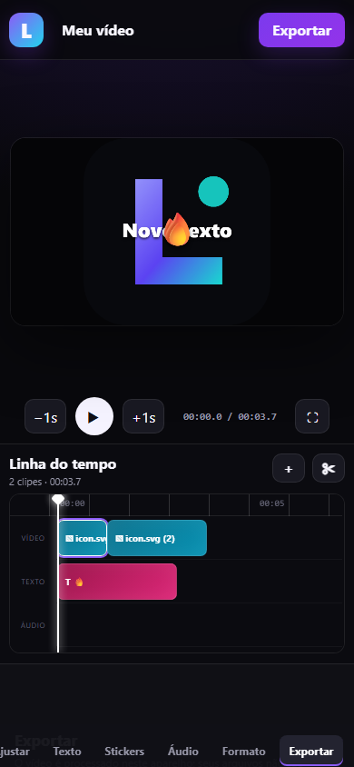

# LumeCut

Editor de vídeo gratuito, original e mobile-first. Funciona como aplicativo web instalável (PWA) e está preparado para virar APK Android ou aplicativo iOS com Capacitor 8.



## Recursos implementados

- Importação de vários vídeos e imagens.
- Linha do tempo sequencial com seleção, divisão, duplicação, exclusão e reordenação.
- Corte de entrada/saída, velocidade de 0,1× a 8× e volume até 200%.
- Zoom, posição, opacidade, rotação, espelhamento, ajuste/preenchimento e fade.
- Brilho, contraste, saturação, temperatura e desfoque.
- Texto e stickers com posição, duração, cor, fundo, sombra, tamanho e rotação.
- Faixas de áudio com volume, ponto inicial, corte e repetição.
- Formatos 9:16, 16:9, 1:1, 4:5 e 4:3.
- Desfazer/refazer, salvamento automático offline e arquivo de projeto `.lumecut`.
- Exportação local em 480p, 720p, 1080p, 1440p, 4K ou 8K e de 24 a 144 fps, sem marca-d'água.
- Destino para galeria/compartilhamento do Android ou download do arquivo.
- Proteção automática contra configurações acima da capacidade estimada do aparelho, com modo experimental opcional.
- Assistente inteligente offline: recebe fotos/vídeos de referência, interpreta instruções em português, monta o ritmo, formato, filtros, transições e título e oferece sugestões durante a edição.
- Efeitos otimizados para Shorts e jogos: tremor, zoom no ritmo, gaming, glitch, fogo, flash, VHS, stop-motion, cinema e jardim.
- Reverso experimental quadro a quadro e sincronização de efeitos por BPM, incluindo detecção da primeira música.
- Biblioteca musical original gerada no aparelho (Gaming Pulse, Neon Drive e Jardim Calmo), livre para usar nos vídeos.
- Importação por link direto autorizado de `.mp3`, `.wav`, `.m4a` ou `.ogg` quando o servidor permite acesso.
- Layout responsivo para celular, tablet e computador.
- Prévia adaptativa: 24 fps/360p em celulares modestos e 30 fps/540p nos demais, sem reduzir a resolução exportada.
- Pausa automática em segundo plano, aceleração gráfica e compartilhamento nativo do vídeo no Android.

## Executar no computador

Requer Node.js 22 ou mais recente.

```sh
npm install
npm start
```

Abra `http://127.0.0.1:4173`.

## Publicar a versão instalável grátis

Envie o projeto para um repositório GitHub, abra **Settings → Pages** e escolha **GitHub Actions** como origem. O workflow `Publicar versão web instalável` publicará o editor em HTTPS. No Android, use **Instalar aplicativo** no navegador; no iPhone/iPad, abra no Safari e escolha **Compartilhar → Adicionar à Tela de Início**.

## Gerar APK Android para celulares

O computador precisa ter Android Studio 2025.2.1 ou mais recente e um Android SDK instalado.

```sh
npm install
npm run native:add:android
cd android
./gradlew assembleDebug
```

No Windows, use `gradlew.bat assembleRelease` depois de configurar a assinatura. O projeto é restrito a celulares com tela sensível ao toque e mantém suporte tanto a processadores ARM de 32 bits quanto de 64 bits no mesmo APK universal. Como o editor não inclui bibliotecas nativas por arquitetura, separar dois APKs aumentaria a manutenção sem melhorar o desempenho.

O workflow `.github/workflows/build-android.yml` produz o arquivo `LumeCut-Android-universal-arm32-arm64.apk`, assinado, otimizado pelo R8 e publicado automaticamente na seção **Releases** para download público.

### Assinatura e atualizações

A pasta local `.signing` contém a chave usada para que futuras versões sejam aceitas como atualização do mesmo aplicativo. Ela é ignorada pelo Git e nunca deve ser publicada. Faça uma cópia de segurança segura dessa pasta: perder a chave impede atualizar instalações existentes.

## Gerar o app para iPhone/iPad

A Apple exige macOS, Xcode 26 ou mais recente e assinatura válida para criar um IPA instalável em aparelhos reais.

```sh
npm install
npm run native:add:ios
npx cap open ios
```

No Xcode, selecione a equipe de assinatura, conecte o aparelho e use **Product → Archive**. Para distribuir, use TestFlight ou App Store. Sem conta paga, o Xcode permite testes pessoais com limitações e expiração da assinatura.

## Testes

```sh
npm test
```

O fluxo de interface foi validado em Chromium nas larguras de desktop e celular, incluindo importação, divisão, desfazer/refazer, texto, sticker, troca de formato e exportação de um MP4 reproduzível. Teste em aparelho físico continua necessário antes de publicar, especialmente no iOS, pois codecs e limites de memória variam conforme o dispositivo.

## Privacidade e limites

O processamento ocorre no aparelho e os arquivos ficam no armazenamento local do navegador. A exportação é feita em tempo real para manter compatibilidade ampla. Projetos muito longos exigem espaço livre e memória proporcionais; mantenha o aplicativo aberto durante a exportação.

O LumeCut não extrai áudio de vídeos do YouTube. Para usar músicas de lá, escolha conteúdo cuja licença permita reutilização, baixe pela Biblioteca de Áudio do YouTube ou obtenha o arquivo diretamente com o autor e importe-o no editor.

4K/120 fps, 8K e 144 fps são opções experimentais porque a disponibilidade real depende do codificador, memória e temperatura do celular. O app recomenda automaticamente uma combinação segura e exige liberação explícita para tentar configurações extremas, evitando fechar ou travar em aparelhos incompatíveis. A assistência inteligente incluída é local e gratuita; ela não envia referências para serviços externos. Modelos generativos de terceiros não estão habilitados porque normalmente exigem infraestrutura e podem ter custo por uso.
